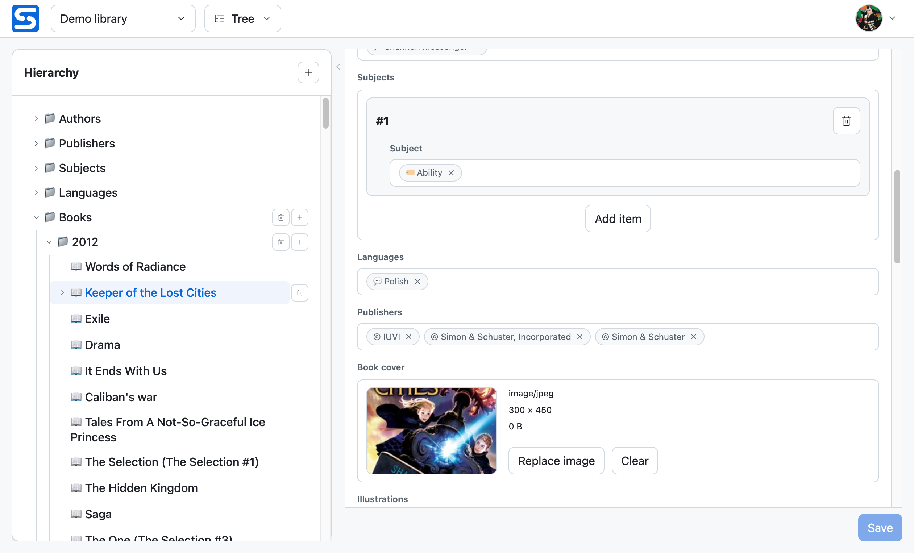
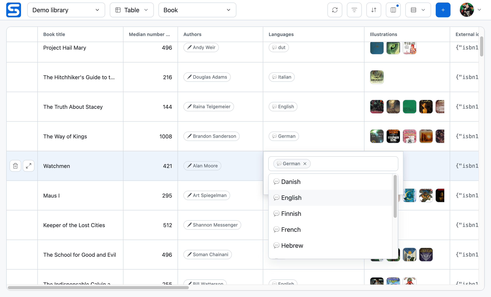
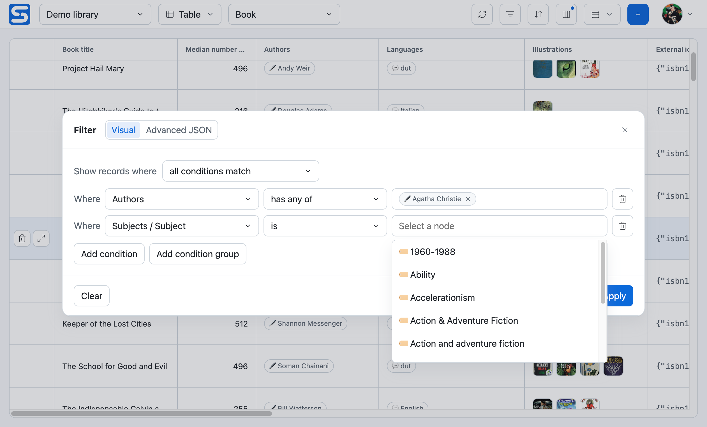
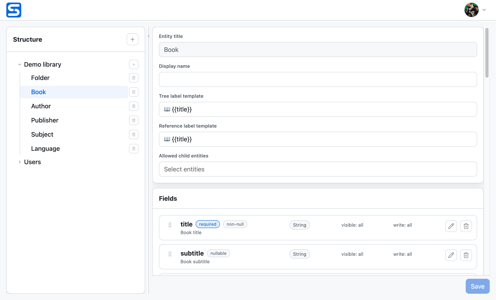

# Using the Admin UI

Sandala Admin UI is the browser workspace for administrators and superusers.
It is a desktop-first application: use a screen at least 900 px wide, with
1100 px or more preferred. Sign in at the Admin UI mount point, normally
`/admin/`. An `admin` can work with nodes and inspect schemas; changing module
or entity structure requires `superuser`.

The backend still enforces node ACL and field write modes. A control that is
not available in the UI is not the only security boundary, and a control that
is visible may still be rejected if the node changes before the request.

## Navigate the workspace

The product logo returns to **Nodes**. The account menu contains **Entities**,
**Settings**, appearance, language, and sign-out actions.

- Use **Tree** when the parent-child hierarchy is the primary context.
- Use **Table** when working with one entity type, filtering records, or
  comparing fields across many nodes.
- Use **Entities** to inspect or, as a superuser, change module and schema
  structure.

## Work with a hierarchy

Choose a module and switch Nodes to **Tree**. Expand branches as needed, then
select a node to load its complete form in the editor pane. The pane can edit
writable fields, choose a compatible parent, and open ACL controls where the
actor has permission. Create a root node from the hierarchy header, or create
a compatible child from a selected node.

The label in the hierarchy comes from the entity's `x-ui.labels.tree` template.
If it has no template, the UI falls back through `name`, `title`, `caption`,
`code`, `description`, and `id`.

Deleting a node is a soft delete and the confirmation explains that its active
subtree is deleted as well. Restore is not available in Admin UI.

## Browse, filter, and edit records

Switch Nodes to **Table**, choose a module and entity, then use the toolbar to
configure the view:

- **Columns** selects visible top-level fields and relevant system fields.
- **Row density** selects Comfortable or Expanded rows.
- **Filter** and **Sort** provide visual builders and an Advanced JSON mode.
- **Create node** opens an editor for the selected entity.

The visual builders expose fields meaningful to the current user. Use Advanced
JSON when the complete query language is needed; its syntax and restrictions
are documented in [Nodes](../reference/rest-api/nodes.md).

Supported scalar and link values can be edited inline. Complex values open an
editor overlay. A link opens its target only when that target is resolvable and
visible to the current actor.

## Design a module or entity

Open **Entities** from the account menu. The left structure panel selects a
module or entity; the right side presents its editor. As a superuser, you can:

1. create a module and define its virtual-root owner, group, populate
   permission, and allowed root entity types;
2. create an entity and set its default node permissions and child-entity
   rules;
3. add, nest, reorder, edit, or remove user fields;
4. set tree and reference label templates.

The entity editor is a schema editor, so the REST schema contract remains the
source for the exact set of legal combinations. See [Entity schemas](../reference/rest-api/entity-schemas.md)
and [Semantic types](../reference/semantic-types.md).

## Manage profile and access tokens

**Settings** opens the current `users/user` node in the ordinary node editor.
Its built-in schema and field permissions determine which values can change.

The **Access tokens** section lists visible personal access tokens and lets a
user create, revoke, or rotate them. A token secret is shown only immediately
after creation or rotation, so copy it before closing the confirmation.

For the complete token lifecycle and API behavior, see [Authentication](../reference/rest-api/authentication.md).
