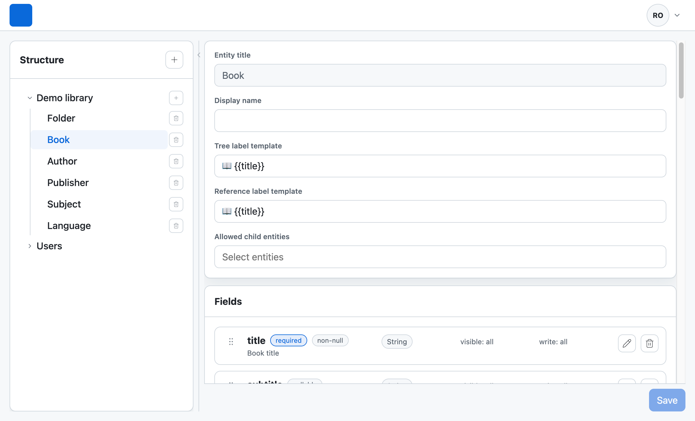

# Sandala

**Define your data. Get an API and an admin UI. Keep the power of MongoDB.**

Sandala is an open-source headless CMS for structured data, built on MongoDB.
Define your data models and get a REST API and a ready-to-use admin UI — with
validation, relationships, permissions, authentication, and file storage built in.

Your data doesn't have to fit into flat tables. Use MongoDB's document model to
embed objects and arrays, connect documents with references, and combine both
approaches in the same model — with schemas that keep your data structured.

## Why Sandala?

- **Model your domain, not just tables.** Nested structures, typed references,
  and optional trees let you organize data the way your application needs.
- **Query through relationships.** Filter and sort by linked data, choose the
  fields you need, and fetch related documents in one API request.
- **Skip building the back office.** Manage schemas, browse data, and edit
  content in an admin UI that follows your data model.
- **Build on the essentials.** Node permissions, field-level access controls,
  users, groups, and local or S3-compatible file storage are already there.
- **Make it yours.** Run Sandala as a standalone backend, extend it with Python
  hooks, or embed it in your own Python application.

## Get started

- [Install Sandala](getting-started/installation.md) — run with Docker or
  install the Python package. The admin UI is included.
- [Follow the quickstart](getting-started/quickstart.md) — define your first
  data model, create records, and query them through the API.
- [Explore the demo library](guides/demo-library.md) — try a sample catalogue
  with books, authors, linked data, and a browsable tree.

## Explore the documentation

- [Concepts](concepts/modules-and-entities.md) — understand the data model,
  schemas, permissions, and links.
- [Guides](guides/designing-a-schema.md) — design schemas, work with data and
  assets, and extend Sandala with hooks or Python integration.
- [Reference](reference/rest-api/overview.md) — look up REST contracts,
  semantic types, configuration, and the Python API.
- [Development](development/architecture.md) — explore the architecture,
  implementation boundaries, and testing practices.
